<div align="center">

## GENESIS'26 HACKATHON
### Team: **FAB4** &nbsp;|&nbsp; Team ID: `GEN26-A0H-H052`

<br />


# Crossroads

### A college community and mentorship platform connecting juniors with seniors and alumni

<sub>Ask a Senior · Discover People · Path Twins · Career Roadmaps · Placement Prep · Interview Simulator</sub>

<br />

[](https://github.com/prajwal-priyadarshan/Amrita_Ascend)
[](https://github.com/prajwal-priyadarshan/Amrita_Ascend)
[](https://github.com/prajwal-priyadarshan/Amrita_Ascend)

<br /><br />


</div>

---

<div align="center">

## Team: FAB4
**Hackathon:** GENESIS'26 &nbsp;|&nbsp; **Team Name:** FAB4 &nbsp;|&nbsp; **Team ID:** `GEN26-A0H-H052`

| Member | Roll No. |
| :--- | :--- |
| **G Prajwal Priyadarshan** | CB.SC.U4AIE24214 |
| **Rithan S** | CB.SC.U4AIE24348 |
| **Kabilan K** | CB.SC.U4AIE24224 |
| **Kishore B** | CB.SC.U4AIE24227 |

</div>

---

<div align="center">

##  &nbsp;About the Project

</div>

Crossroads is a full-stack mentorship and career-readiness platform built for a college community. Juniors get direct, searchable access to the experience of seniors and alumni — real interview breakdowns, honest club reviews, matched mentors, and a personalised roadmap toward their goals — instead of scattered WhatsApp groups and word of mouth.

The platform is built phase by phase against a written product spec (`docs/PRD.md`) and technical spec (`docs/TRD.md`), with each phase tagged in git history. It combines a traditional CRUD application (questions, profiles, teams, events, roadmaps) with a server-side AI layer that is fully optional — every AI-backed feature degrades gracefully to a deterministic, non-AI fallback when no API key is configured.

<div align="center">

### Core Feature Areas

</div>

| | Feature | What it does |
|:---:|---|---|
|  | **Ask a Senior** | Question and answer threads with AI-assisted, citation-grounded answers drawn from real senior responses |
|  | **Discover People** | Matched mentor/mentee suggestions with an explained match score |
|  | **Path Twins** | Finds students who walked a similar path and explains the overlap |
|  | **Companies & Placement Prep** | Round-wise interview experiences, skills-gap analysis, and an adaptive practice simulator |
|  | **Roadmaps** | AI-generated, year-by-year milestone plans tailored to a student's goals |
|  | **Community** | Clubs, teams, opportunities, events, stories, and a giving/campaign module |
|  | **Crossroads Assistant** | An in-app chat concierge that can answer questions about the platform itself |

<div align="center">

### Design Principles

</div>

| | Principle |
|:---:|---|
|  | Code is the source of truth; the docs in `docs/phases/` are build guides, not the current state |
|  | Every rule that touches points, badges, or counters runs inside a Prisma transaction with a unique-constraint guard against double-processing |
|  | Search is plain PostgreSQL full-text + trigram indexing — no vector database |
|  | Every AI feature has a written, working fallback path for when `AI_API_KEY` is unset |
|  | Nothing is hardcoded: deployment values live in `config/env.ts`, tuning numbers in `config/constants.ts`, public settings are served from `GET /api/config` |

---

<div align="center">

##  &nbsp;Tech Stack

### Frontend


<sub>React 19 · Vite 8 (rolldown) · TypeScript 6 · Tailwind CSS v4 · shadcn/ui (Radix) · React Router · TanStack Query v5 · Zustand · Recharts · Motion</sub>

<br /><br />

### Backend


<sub>Node.js 22 LTS · Express 5 · zod v3 (shared validation) · Prisma 7 ORM · jsonwebtoken (httpOnly cookie) · pino logging · helmet + cors</sub>

<br /><br />

### AI


<sub>Groq (free-tier inference) · openai SDK (OpenAI-compatible client) · Llama 3.3 70B default model (`openai/gpt-oss-120b`) · PostgreSQL FTS retrieval · in-memory cache, 60-minute TTL</sub>

<br /><br />

### Data and Infrastructure


<sub>PostgreSQL 16+ primary database · Neon serverless Postgres (pooled + direct URL) · Vercel web hosting + `/api` rewrite · Render API hosting</sub>

</div>

---

##  &nbsp;How It Works

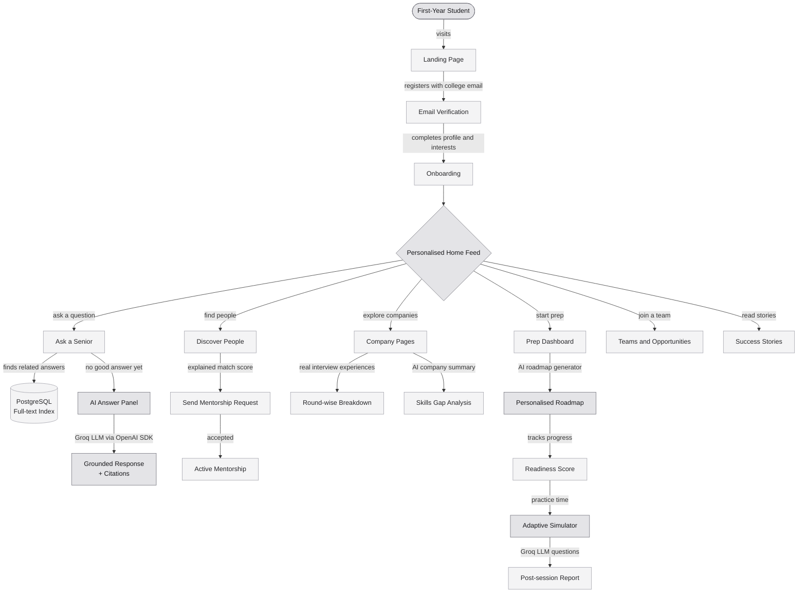

---

##  &nbsp;System Architecture

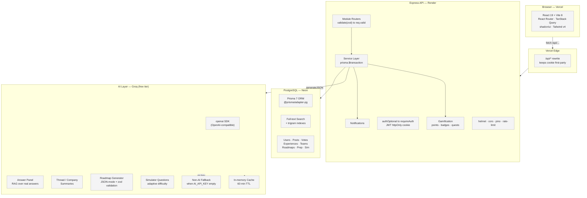

---

##  &nbsp;AI Layer Deep-Dive

Crossroads's AI features run **server-side only**, through any OpenAI-compatible provider (Groq free tier by default). Every feature has a graceful non-AI fallback so the app works even without an `AI_API_KEY`.

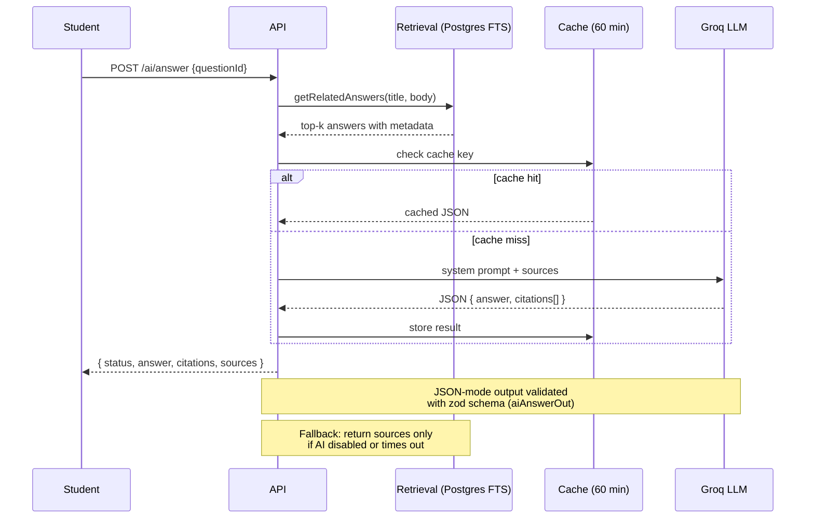

| Feature | Prompt strategy | Model output | Fallback |
|---|---|---|---|
| **Answer Panel** | RAG over senior answers, citation format `[n]` | `{ answer, citations[] }` | Show raw matching answers |
| **Thread / Company Summary** | Summarise 3-5 bullets, cite specific items | `{ bullets[], citations[] }` | Hide summary card |
| **Roadmap Generator** | Skills gap to year-by-year milestones | `{ milestones[], gaps[] }` | Template-based roadmap |
| **Simulator Questions** | Role + topic + difficulty to MCQ/open | `{ question, options[], answer, explanation }` | Bank of pre-written questions |

---

##  &nbsp;Repository Layout

```
apps/
  api/                     Express API
    src/
      modules/<domain>/    routes · service · serializers per feature
      services/            matching · feedRank · twins · quests · gamification · notify
      config/              env.ts (all process.env) · constants.ts (tuning numbers)
      lib/                 prisma · errors · ai · cache
      docs/                openapi.ts (Swagger built from zod schemas)
    prisma/                schema.prisma · migrations/ · sql/search.sql
    scripts/               seed-users.ts · seed-content.ts · smoke.ts
    test/unit/             Vitest tests (matching · feedRank · levels · helpers)

  web/                     React app
    src/
      app/                 router.tsx · providers · pages (404, MeRedirect)
      components/          ui/ · layout/ · guards/ · shared/
      features/<name>/     pages + api.ts (TanStack Query hooks) per feature

packages/
  shared/                  zod schemas · response types · constants (used by both apps)

docs/                      PRD.md · TRD.md · phases/phase-00..11.md
```

---

##  &nbsp;Getting Started

**Requirements:** Node 22+, npm 10+, PostgreSQL (Neon recommended).

```bash
npm install
cp apps/api/.env.example apps/api/.env    # fill DATABASE_URL, DIRECT_URL, JWT_SECRET
cp apps/web/.env.example apps/web/.env

npm run db:deploy -w apps/api             # run migrations
npm run db:search -w apps/api             # apply FTS + trigram indexes
npm run db:seed:all                       # base data + 30 demo users + content (~3 min)

npm run dev                               # API :4000  web :5173
```

Open [http://localhost:5173](http://localhost:5173) and use a demo account (password `demo12345`). AI features need `AI_API_KEY` in `.env` — leave it empty and all AI panels gracefully fall back.

---

##  &nbsp;Everyday Commands

| Command | What it does |
|---|---|
| `npm run dev` | API (tsx watch) + web (Vite) together |
| `npm run typecheck` | Types for shared, API and web |
| `npm test` | Vitest unit tests |
| `npm run smoke` | End-to-end API checks against a running API |
| `npm run lint` | oxlint across all packages |
| `npm run build` | Production builds (API via tsup, web via Vite) |

---

##  &nbsp;Key Design Decisions

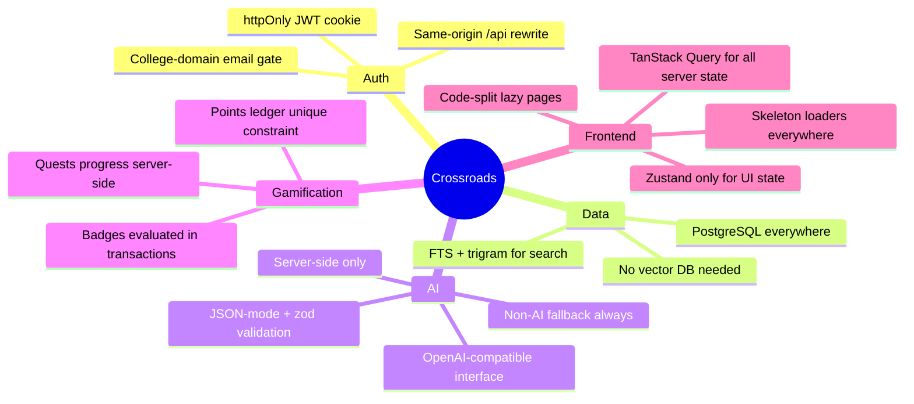

---

##  &nbsp;API Documentation

With the API running, open **Swagger UI at [http://localhost:4000/api/docs](http://localhost:4000/api/docs)**.
Sign in via `POST /auth/demo-login` from the docs page to try authenticated endpoints.
Disabled in production unless `API_DOCS_ENABLED=true`.

---

<div align="center">

##  &nbsp;Screenshots

</div>

### 1. Landing Page
*First touchpoint introducing Crossroads: hero banner, value proposition, core features, and college email authentication.*

<p align="center">
  <a href="docs/screenshots/landing-page.webp">
    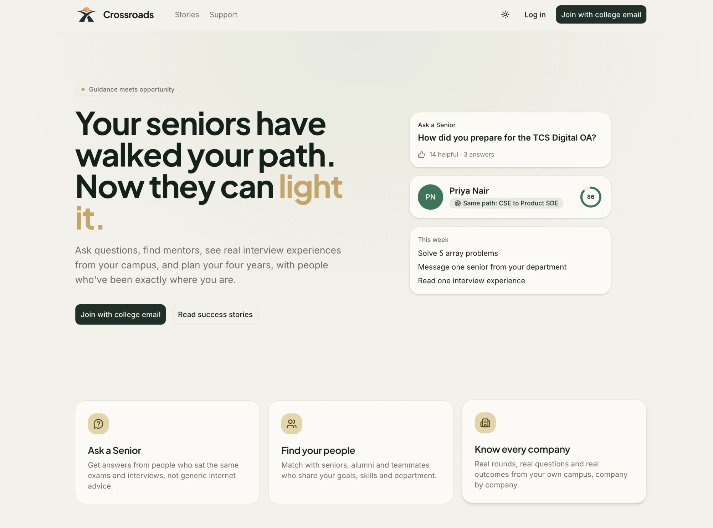
  </a>
</p>

<br />

### 2. Personalised Home Feed
*Dynamic student hub featuring daily quests, peer updates, recommended mentors, and career readiness tracking.*

<p align="center">
  <a href="docs/screenshots/home-feed.webp">
    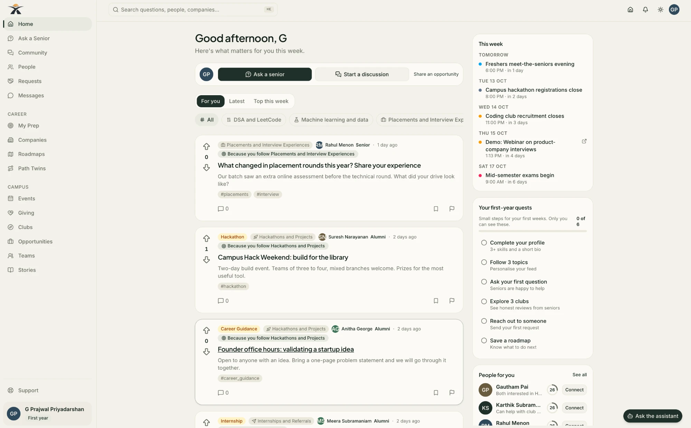
  </a>
</p>

<br />

### 3. Everything in One Place (Platform Directory)
*Interactive capability map organizing academic guidance, career roadmaps, placement prep, and campus communities.*

<p align="center">
  <a href="docs/screenshots/everything-in-one-place.webp">
    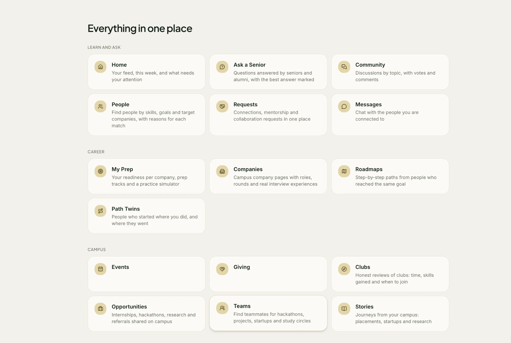
  </a>
</p>

<br />

### 4. Ask a Senior (Q&A with Grounded AI Citations)
*Threaded community discussions with verified senior answers and AI-grounded citation panels.*

<p align="center">
  <a href="docs/screenshots/ask-a-senior.webp">
    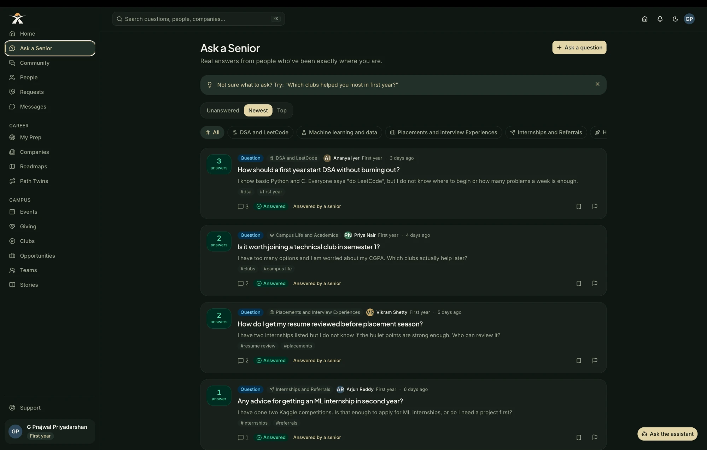
  </a>
</p>

<br />

### 5. Companies & Placement Preparation
*Round-wise interview debriefs, skill gap roadmaps, and adaptive practice questions.*

<p align="center">
  <a href="docs/screenshots/companies.webp">
    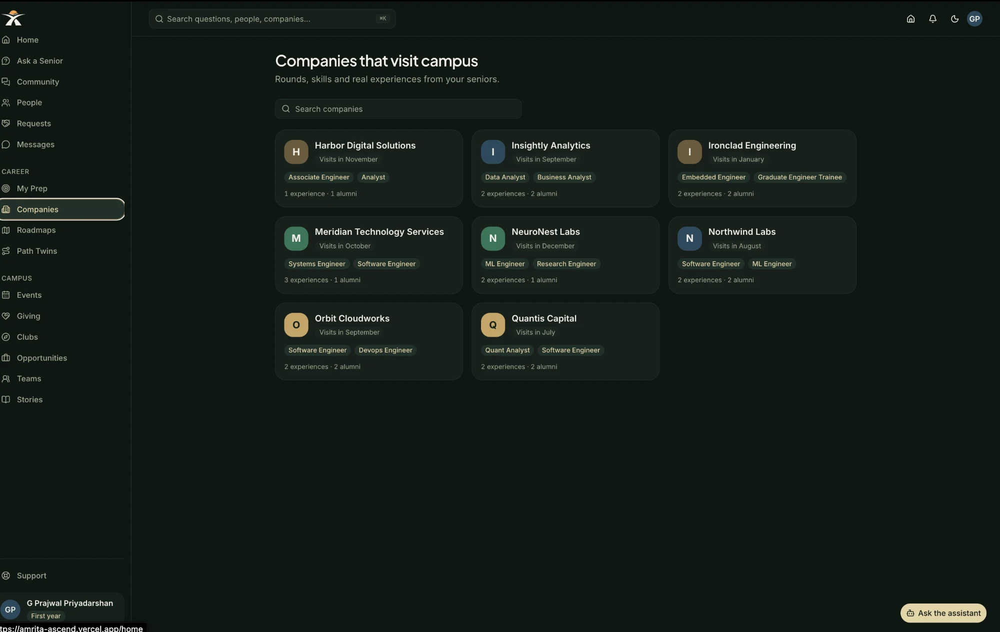
  </a>
</p>

<br />

### 6. Path Twins (Peer Trajectory Matching)
*Matching juniors with seniors who took similar paths, comparing coursework, electives, projects, and careers.*

<p align="center">
  <a href="docs/screenshots/path-twins.webp">
    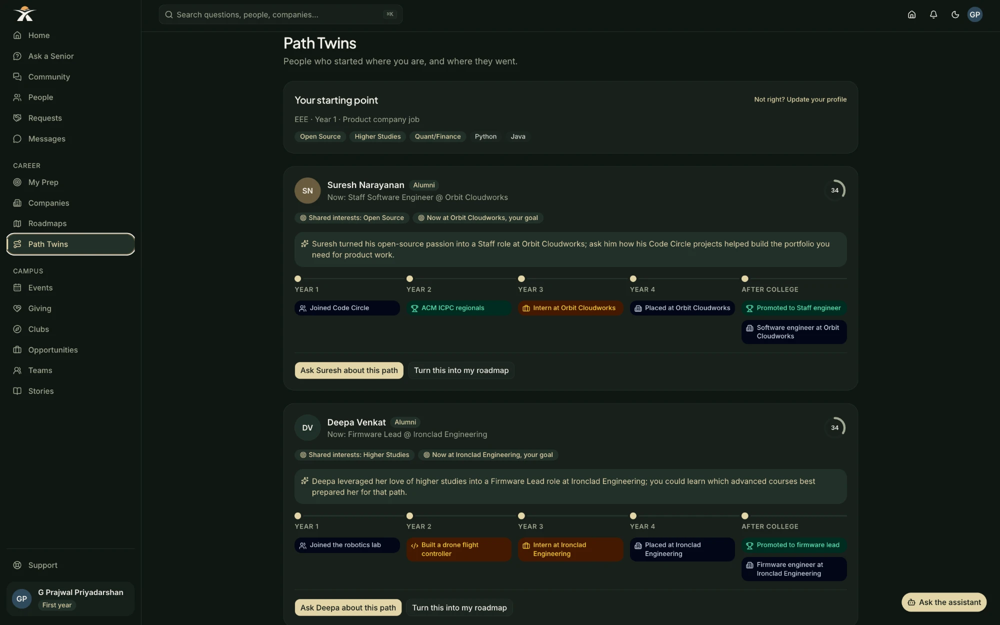
  </a>
</p>

<br />

### 7. Community & Student Teams
*Project collaboration, club hubs, hackathon squad recruitment, and study circles.*

<p align="center">
  <a href="docs/screenshots/teams.webp">
    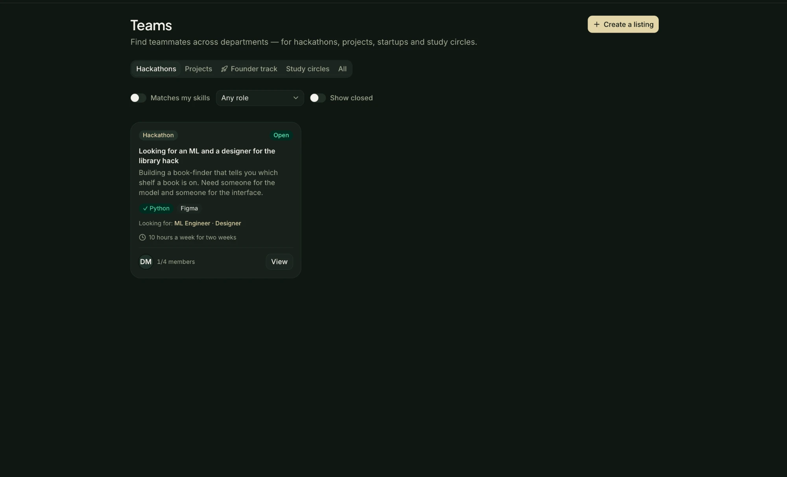
  </a>
</p>

---

##  &nbsp;Specification

| Document | Contents |
|---|---|
| [`docs/PRD.md`](docs/PRD.md) | What and why — features F01-F57, demo story, wellbeing |
| [`docs/TRD.md`](docs/TRD.md) | How — full stack, schema, algorithms, AI, deployment |
| [`docs/phases/`](docs/phases/) | Phase-by-phase build guides (Phase 00-11) |
