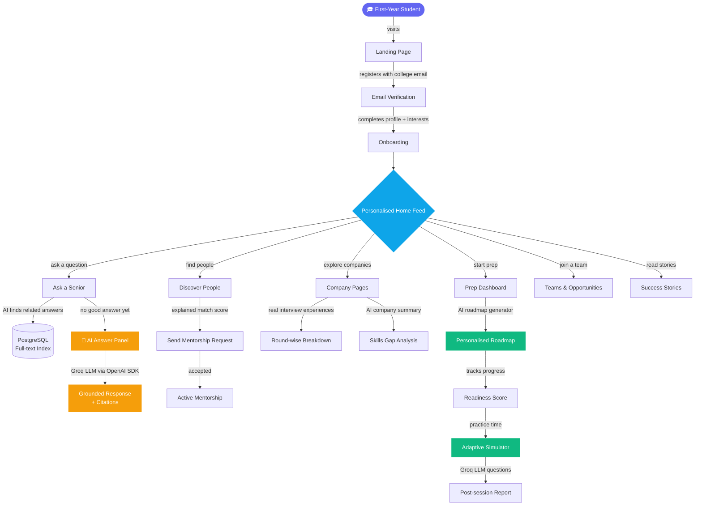
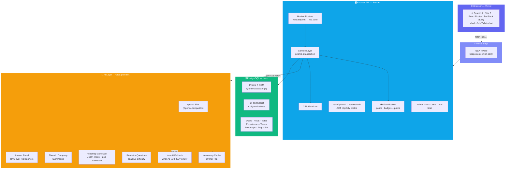
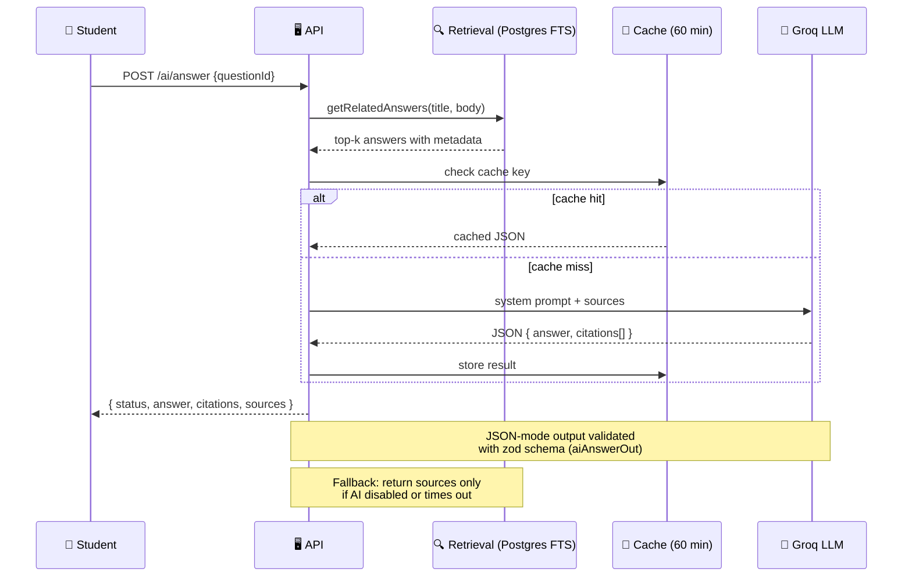
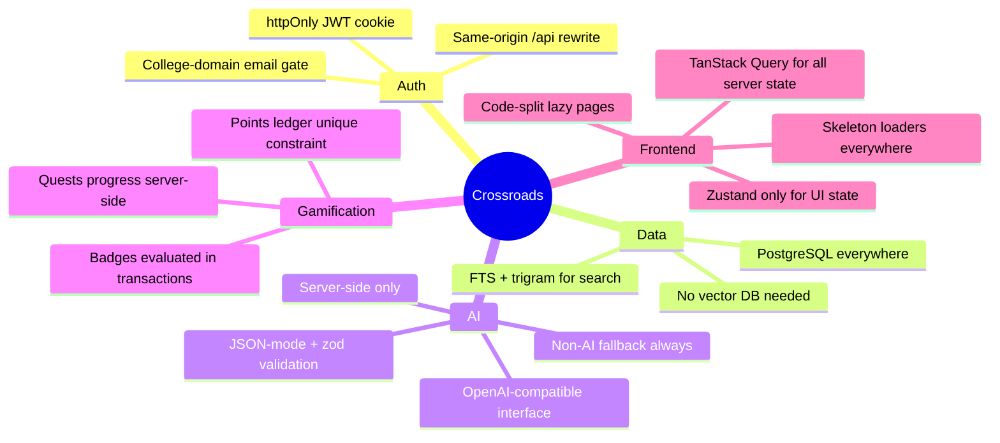

# 🌉 Crossroads

> **A college community and mentorship platform that connects juniors with seniors and alumni.**
> Ask a Senior · Discover People · Path Twins · Career Roadmaps · Placement Prep · Simulator

---

## 🗺️ How It Works



---

## 🏗️ System Architecture



---

## 🤖 AI Layer Deep-Dive

Crossroads's AI features run **server-side only**, through any OpenAI-compatible provider (Groq free tier by default). Every feature has a graceful non-AI fallback so the app works even without an `AI_API_KEY`.



| Feature | Prompt strategy | Model output | Fallback |
|---|---|---|---|
| **Answer Panel** | RAG over senior answers, citation format `[n]` | `{ answer, citations[] }` | Show raw matching answers |
| **Thread / Company Summary** | Summarise 3–5 bullets, cite specific items | `{ bullets[], citations[] }` | Hide summary card |
| **Roadmap Generator** | Skills gap → year-by-year milestones | `{ milestones[], gaps[] }` | Template-based roadmap |
| **Simulator Questions** | Role + topic + difficulty → MCQ/open | `{ question, options[], answer, explanation }` | Bank of pre-written questions |

---

## 🛠️ Tech Stack

### Frontend

| | Technology | Purpose |
|---|---|---|
|  | **React 19** | UI framework |
|  | **Vite 8** (rolldown) | Dev server & bundler |
|  | **TypeScript 6** | Type safety everywhere |
|  | **Tailwind CSS v4** | Utility-first styling |
|  | **shadcn/ui** (Radix) | Accessible components |
|  | **React Router** | Client-side routing |
|  | **TanStack Query v5** | Server state & caching |
|  | **Zustand** | Minimal client state |
|  | **Recharts** | Prep & readiness charts |
| -0055FF?style=flat&logo=framer&logoColor=white) | **Motion** | Animations & transitions |

### Backend

| | Technology | Purpose |
|---|---|---|
|  | **Node.js 22 LTS** | Runtime |
|  | **Express 5** | HTTP framework |
|  | **zod v3** | Schema validation (shared) |
|  | **Prisma 7** | ORM + migrations |
|  | **jsonwebtoken** | httpOnly cookie auth |
|  | **pino** | Structured request logging |
|  | **helmet + cors** | Security headers |

### AI

| | Technology | Purpose |
|---|---|---|
|  | **Groq** (free tier) | LLM inference provider |
|  | **openai SDK** | OpenAI-compatible client |
| 🦙 | **Llama 3.3 70B** | Default model (`openai/gpt-oss-120b`) |
| 🔍 | **PostgreSQL FTS** | Retrieval (RAG sources) |
| 💾 | **In-memory cache** | 60-min TTL per question key |

### Data & Infrastructure

| | Technology | Purpose |
|---|---|---|
|  | **PostgreSQL 16+** | Primary database |
|  | **Neon** | Serverless Postgres (pooled + direct URL) |
|  | **Vercel** | Web app hosting + `/api` rewrite |
|  | **Render** | API hosting |

---

## 📦 Repository Layout

```
apps/
  api/                     Express API
    src/
      modules/<domain>/    routes · service · serializers per feature
      services/            matching · feedRank · twins · quests · gamification · notify
      config/              env.ts (all process.env) · constants.ts (tuning numbers)
      lib/                 prisma · errors · ai · cache
      docs/                openapi.ts (Swagger built from zod schemas)
    prisma/                schema.prisma · migrations/ · sql/search.sql
    scripts/               seed-users.ts · seed-content.ts · smoke.ts
    test/unit/             Vitest tests (matching · feedRank · levels · helpers)

  web/                     React app
    src/
      app/                 router.tsx · providers · pages (404, MeRedirect)
      components/          ui/ · layout/ · guards/ · shared/
      features/<name>/     pages + api.ts (TanStack Query hooks) per feature

packages/
  shared/                  zod schemas · response types · constants (used by both apps)

docs/                      PRD.md · TRD.md · phases/phase-00..11.md
```

---

## 🚀 Getting Started

**Requirements:** Node 22+, npm 10+, PostgreSQL (Neon recommended).

```bash
npm install
cp apps/api/.env.example apps/api/.env    # fill DATABASE_URL, DIRECT_URL, JWT_SECRET
cp apps/web/.env.example apps/web/.env

npm run db:deploy -w apps/api             # run migrations
npm run db:search -w apps/api             # apply FTS + trigram indexes
npm run db:seed:all                       # base data + 30 demo users + content (~3 min)

npm run dev                               # API :4000  web :5173
```

Open [http://localhost:5173](http://localhost:5173) and use a demo account (password `demo12345`). AI features need `AI_API_KEY` in `.env` — leave it empty and all AI panels gracefully fall back.

---

## ⚡ Everyday Commands

| Command | What it does |
|---|---|
| `npm run dev` | API (tsx watch) + web (Vite) together |
| `npm run typecheck` | Types for shared, API and web |
| `npm test` | Vitest unit tests |
| `npm run smoke` | End-to-end API checks against a running API |
| `npm run lint` | oxlint across all packages |
| `npm run build` | Production builds (API via tsup, web via Vite) |

---

## 🔑 Key Design Decisions



---

## 📖 API Documentation

With the API running, open **Swagger UI at [http://localhost:4000/api/docs](http://localhost:4000/api/docs)**.  
Sign in via `POST /auth/demo-login` from the docs page to try authenticated endpoints.  
Disabled in production unless `API_DOCS_ENABLED=true`.

---

## 📚 Specification

| Document | Contents |
|---|---|
| [`docs/PRD.md`](docs/PRD.md) | What & why — features F01–F57, demo story, wellbeing |
| [`docs/TRD.md`](docs/TRD.md) | How — full stack, schema, algorithms, AI, deployment |
| [`docs/phases/`](docs/phases/) | Phase-by-phase build guides (Phase 00–11) |
